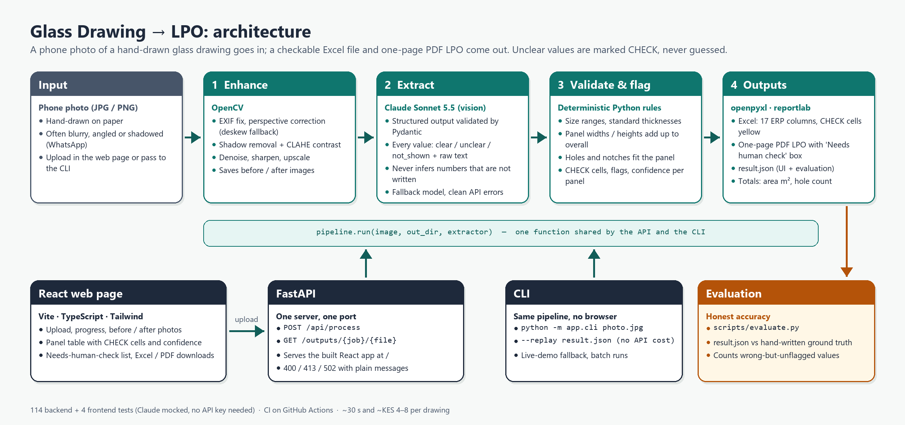
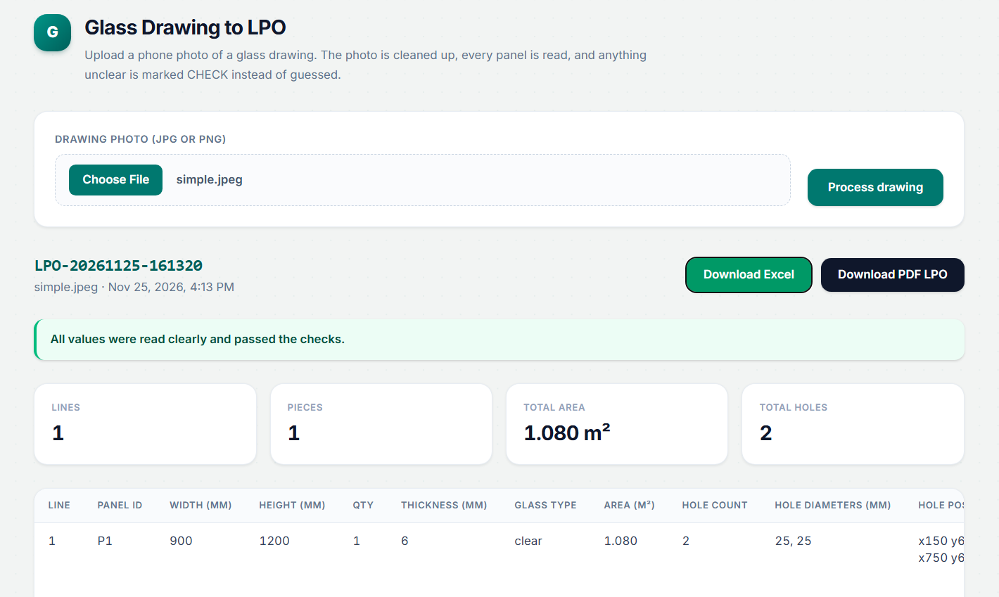
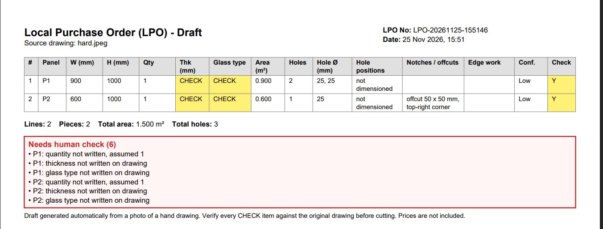
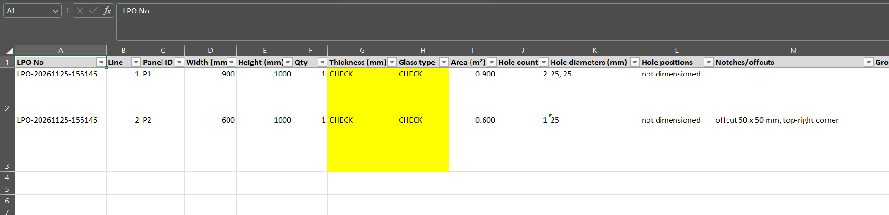
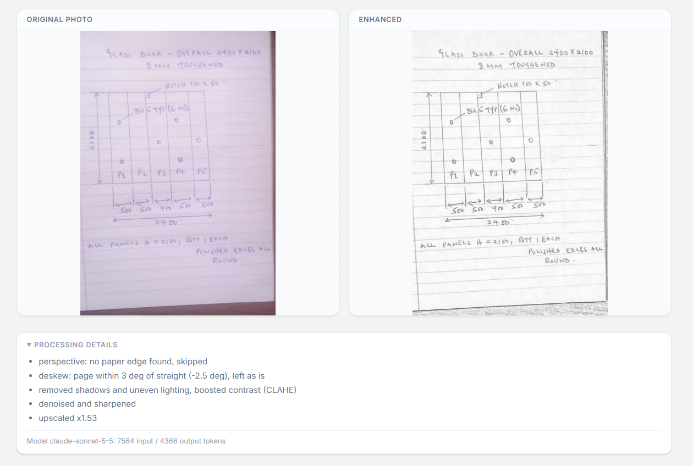

# Glass Drawing → LPO

[](https://github.com/ochiengherman36/glass-lpo/actions/workflows/ci.yml)

Turns a phone photo of a hand-drawn glass drawing into a checkable order: it cleans up the photo, reads every
panel's size, holes, notches and offcuts with Claude, checks the numbers with fixed rules, and writes an
ERP-ready **Excel file** and a **one-page PDF LPO**. Anything that cannot be read clearly is marked **CHECK** and
listed in a "Needs human check" box. Values are never guessed.



## Results on the test drawings

Three drawings drawn on paper and photographed with a phone. The answer for each was written down
(`ground-truth-*.json`) before scoring. Full report: [`test_drawings/EVALUATION.md`](test_drawings/EVALUATION.md).

| Drawing | Fields right | Wrong and not flagged | Flagged for a human |
|---|---|---|---|
| Simple: 1 panel, 2 holes | 12/12 | 0 | none |
| Realistic: door, 5 panels, notch, 6 × Ø25 holes | 47/47 | 0 | none |
| Hard: 2 panels, offcut, nothing written for qty/thickness/glass | 20/20 | 0 | qty, thickness, glass type (correctly) |
| **Total** | **79/79** | **0** | |

On an earlier, messier set of photos the system scored 76/79 with **0 wrong values unflagged**: the 3 misses
were all unclear handwriting it marked CHECK instead of guessing (commit `f1b190f`).

### Client drawings (real, mixed units)

Four real handwritten drawings from the client, in metres, centimetres, feet, millimetres and inches with
fractions. Ground truth was committed before the system ran (commit `2107cd1`); each drawing was run once and these
are the first-run results. Full report: [`test_drawings/EVALUATION-client-drawings.md`](test_drawings/EVALUATION-client-drawings.md).

| Drawing | Units | Fields right | Wrong and not flagged | Notes |
|---|---|---|---|---|
| `images 16`: 2 doors + sliding window | m, cm | 31/31 | 0 | Door sizes left as CHECK, not split from the frame size |
| `images 17`: 2 windows + door | feet | 19/23 | 2 | Read the window as 2 × 2 ft panes in a 4 ft window; ground truth treats those sizes as conflicting |
| `images 18`: oak double door | mm | 15/20 | 4 | Copied "14mm unit" verbatim (ground truth: "double glazed unit"); did not record or flag "Bevel" |
| `sd42teinfr7f1`: 3-panel screen | inches, fractions | 8/14 | 3 | Read 3 panels and a top strip as one panel; its width and height were flagged |
| **Total** | | **73/88 (83%)** | **9** | |

Every unit was converted correctly, no glass size was derived from a door or frame size, aluminium and timber
parts were left out, and every missing or partial dimension was flagged. The evaluator's panel matching was fixed
after this run (it compared a door with a window pane); before that fix the score read 70/88 with 12 unflagged.

## Setup

Requires [uv](https://docs.astral.sh/uv/) (installs Python 3.12 for you) and an
[Anthropic API key](https://console.anthropic.com/). Node is only needed to change the UI: the built page is
committed in `backend/static`.

```bash
git clone https://github.com/ochiengherman36/glass-lpo.git
cd glass-lpo/backend
uv sync
cp .env.example .env          # then put your key in ANTHROPIC_API_KEY
uv run uvicorn app.main:app
```

Open http://localhost:8000, upload a drawing photo and download the Excel and PDF.

Settings in `backend/.env`:

| Variable | Default | Meaning |
|---|---|---|
| `ANTHROPIC_API_KEY` | required | Your Claude API key (never committed) |
| `ANTHROPIC_MODEL` | `claude-opus-5-5` | Model used; the results above used `claude-sonnet-5-5` |
| `ANTHROPIC_EFFORT` | `high` | Reasoning effort |
| `ANTHROPIC_MAX_TOKENS` | `16000` | Answer length limit |
| `ANTHROPIC_USE_FALLBACKS` | `true` | Retry on a fallback model if a request is declined |
| `MAX_UPLOAD_MB` | `15` | Largest accepted photo |

## Usage

**Web page:** `uv run uvicorn app.main:app`, then http://localhost:8000.

**Command line** (same pipeline, no browser; from `backend/`):

```bash
uv run python -m app.cli ../test_drawings/hard/hard.jpeg --out ../test_drawings/hard/output
```

Prints each panel, the totals and every flag, and writes `<photo>-original.jpg`, `<photo>-enhanced.jpg`
(e.g. `hard-enhanced.jpg`), `LPO-….xlsx`, `LPO-….pdf` and `result.json`.

**Replay without API cost:** rebuilds the Excel and PDF from a saved reading, for example after changing a rule:

```bash
uv run python -m app.cli ../test_drawings/hard/hard.jpeg --out out --replay ../test_drawings/hard/output/result.json
```

**API:** `POST /api/process` (multipart `file`) returns the panels, flags, totals, token usage and download URLs.
`GET /api/health` returns `{"status": "ok"}`.

**UI development:** in `frontend/`, run `npm install` and `npm run dev` (http://localhost:5173, proxies `/api` to
port 8000). Run `npm run build` to update `backend/static`.

## Tests and evaluation

```bash
# in backend/
uv run pytest                     # 153 tests; Claude is mocked, so no key and no cost
RUN_LIVE=1 uv run pytest -m live  # optional: one real Claude call (PowerShell: $env:RUN_LIVE="1"; uv run pytest -m live)

# in frontend/
npm test                          # 4 UI tests

# in the repo root
python scripts/evaluate.py        # score test_drawings/*/output against ground truth
python scripts/evaluate.py test_drawings/client-* --report EVALUATION-client-drawings.md   # client drawings only
```

The evaluator counts each field as correct, flagged but right (a false CHECK), flagged and wrong, or
**wrong and not flagged**. The last one is the number that matters: a bad value that would reach the cutting table.

## Model and cost

- **Model:** Claude Sonnet 5.5 (`claude-sonnet-5-5`) with vision and structured output. Set
  `ANTHROPIC_MODEL=claude-opus-5-5` for a stronger reader at about twice the price.
- **Measured per drawing:** about 7,500 input and 1,400–4,300 output tokens, about **$0.03–0.06, roughly
  KES 4–8** (at $2 / $10 per million tokens and KES 129 to the dollar). About 30 seconds end to end.

## How it works

1. **Enhance** (`app/enhance.py`, OpenCV): fixes phone rotation, squares up the page when its edges are
   visible (otherwise deskews, but only when the tilt is clear), removes shadows, boosts contrast, denoises,
   sharpens and upscales. Every step taken is listed in the output.
2. **Extract** (`app/extract.py`, `app/schema.py`): sends the cleaned and original photo to Claude with a strict
   schema. Each number comes back as `clear`, `unclear` or `not_shown` with the raw text seen and the unit written
   next to it, and the prompt forbids inferring numbers that are not written. A sheet with several items (e.g. doors
   and a window) lists each item with its own overall size.
3. **Convert units** (`app/units.py`): Python, not Claude, converts m, cm, ft, inches, fractions and feet-and-inches
   to whole millimetres, keeps the original text in the notes, and checks the number against the text Claude copied.
   A missing unit, an assumed unit or a mismatch is marked CHECK.
4. **Validate** (`app/validate.py`): fixed rules mark CHECK for unclear or missing sizes; sizes outside 50–3,300 mm;
   non-standard thicknesses; panel widths that don't add up to the overall width of their item (±5 mm); holes or
   notches that don't fit the panel; a stated hole count that doesn't match the holes drawn. Each panel gets a
   confidence level.
5. **Outputs** (`app/excel.py`, `app/pdf_lpo.py`): Excel with the 17 requested columns (CHECK cells in yellow) and a
   one-page PDF LPO with an LPO number, date, line items, total m², total holes and the "Needs human check" box.
   No prices.

## Project layout

```
backend/
  app/        enhance, extract, schema, units, validate, lpo, excel, pdf_lpo, pipeline, main (FastAPI), cli, config
  tests/      unit and API tests with a fake Claude client
  static/     built React page served by FastAPI
frontend/     Vite + React + TypeScript + Tailwind (upload, CHECK table, flags, downloads)
scripts/      evaluate.py (accuracy against ground truth)
test_drawings/<name>/   photo, ground truth, output/ (enhanced image, Excel, PDF, result.json)
docs/         architecture diagram and screenshots
```

## Known limitations

- Tested on seven drawings only (three of my own, four from the client); the scores show the approach, not
  production accuracy.
- Panel structure is the weakest point: on the inch drawing Claude merged three panels and a top strip into one,
  and it does not flag such judgement calls (or a label it decides is not about the glass, such as "Bevel").
- A value with no unit is assumed to be inches when it is a fraction, or the sheet's only other unit, and is always
  flagged; a sheet that mixes units and leaves one off is flagged, not guessed.
- Hole positions are only filled when the drawing dimensions them; positions are measured from the panel's
  bottom-left corner, which still needs confirming with the client.
- The width and height sum checks assume one row or one column of panels; grid layouts may be over-flagged.
- Perspective correction needs the paper's edges against a darker background; curved pages are not flattened
  and tilts under 3° are left alone.
- Claude's reading varies slightly between runs (an overwritten digit may come back as `CHECK (400?)` or
  `CHECK`); the rules make sure the variation is flagged, not hidden.
- No login, rate limit or file clean-up: every upload uses the API key.
- LPO numbers are timestamp-based (`LPO-YYYYMMDD-HHMMSS`), not the client's ERP sequence. No pricing.

## Screenshots

**Web page after processing the simple drawing.** Every value was read clearly, so nothing needs checking. On a
drawing with unclear values, those cells turn amber and the flags are listed below the table.



**The one-page PDF LPO for the hard drawing,** with the "Needs human check" box.



**The Excel export for the hard drawing:** the requested columns, one row per panel, CHECK cells in yellow.



**Image enhancement:** the original phone photo next to the cleaned-up version sent to Claude.


